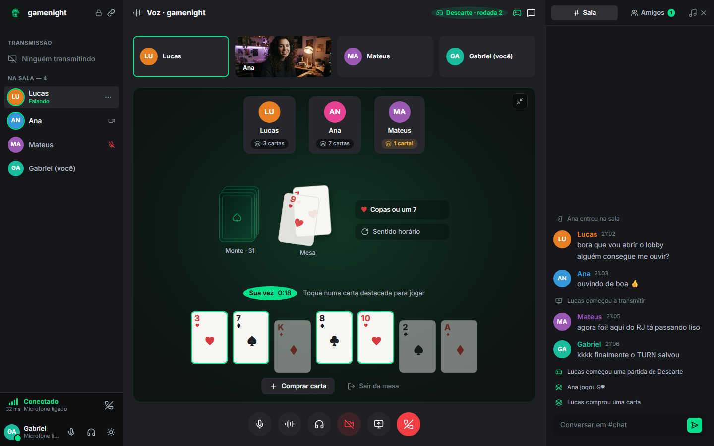

# Explorer for Penpot

Browse your [Penpot](https://penpot.app) designs without leaving VS Code: teams, projects, files, pages and boards in the sidebar, and a preview of any board in an editor tab.

> **Unofficial.** Explorer for Penpot is a community extension made by TwoGuysDev. It is not made, endorsed or supported by Penpot or Kaleidos.



## Features

- **Sidebar explorer**: teams → projects → files → pages → boards, with each board's size.
- **Board preview**: click a board to see it in a tab, drawn as SVG from Penpot's data (layouts, text, images, gradients, strokes, shadows and blur). Switch between *fit to window* and *100%*.
- **Compare with Penpot's thumbnail**: when the Penpot editor has already generated a thumbnail for the board, show it next to the preview.
- **Open `.penpot` files**: click a `.penpot` export in your workspace (for example one committed next to your code) to browse its pages and boards and see them drawn, with the images inside the file. No connection or token needed, and the view refreshes when the file changes. The **Workspace Files** section of the Penpot sidebar lists every `.penpot` in the workspace as a tree (file → pages → boards); click a board to open it.
- **Edit with AI (MCP)**: a local MCP server lets AI assistants such as Claude Code read and edit the `.penpot` files of your workspace, with no browser and no Penpot server. See [Edit designs with AI](#edit-designs-with-ai-mcp).
- **Open in Penpot**: jump from a file, page or board straight to the Penpot editor in your browser.
- **Penpot Cloud and self-hosted**: works with `design.penpot.app` and with your own instance (including `localhost`).
- **English and Brazilian Portuguese.**

## Getting started

1. Install the extension and click the **Penpot** icon in the activity bar.
2. Click **Connect to Penpot** and choose **Penpot Cloud** or enter the address of your self-hosted Penpot.
3. Create a personal access token in Penpot: **Your account → Integrations → Access tokens → Generate new token**, then paste it.

The token is checked against your Penpot before it is saved.

### Self-hosted Penpot

Access tokens must be enabled on your instance. Add `enable-access-tokens` to `PENPOT_FLAGS` (for both frontend and backend) and restart Penpot. With the official Docker setup, that is the `x-flags` line of `docker-compose.yaml`.

## Edit designs with AI (MCP)

The extension can run an [MCP](https://modelcontextprotocol.io) server so an AI assistant edits your designs directly in the `.penpot` files of the workspace. Nothing else has to be open: no browser tab, no Penpot desktop app, no Docker.

1. Run **Penpot: Start MCP Server** (or turn on `penpotExplorer.mcp.enabled`). A **Penpot MCP** item appears in the status bar.
2. Run **Penpot: Copy MCP Setup for Claude Code** and paste the command in a terminal:
   ```sh
   claude mcp add --transport http penpot-explorer http://127.0.0.1:4410/mcp
   ```
   Other MCP clients connect to the same address (Streamable HTTP).
3. Ask for changes, for example *"in home.penpot, make the hero title 40px and add a Sign up button under it"*.

Tools: `list_designs`, `get_structure`, `get_layers`, `get_shapes`, `edit` (create, update, move, duplicate and delete in one batch, saved once) and `screenshot` (a PNG of a board, also shown in a **Penpot MCP** tab).

- **Flex layouts are laid out like in Penpot**: after each edit the server places the children of flex boards (direction, gap, padding, justify, align, wrap, fill/auto sizes, margins, min/max). Grid boards keep their children where they are.
- **Text sizes are estimated** until the file is opened in Penpot, which measures them with the real fonts.
- **Components**: changes inside copies become overrides; mains cannot be deleted through MCP.
- Edited boards lose the thumbnail stored in the export; Penpot makes a new one when you import the file.
- To keep working in Penpot, import the `.penpot` (**Projects → Import**). Files of your Penpot account are listed read-only for now: export them as `.penpot` into the workspace to edit them.

## Privacy and security

- Your access token is stored in VS Code's **secret storage** (your operating system's credential store), never in settings or files.
- `.penpot` files are read locally and never sent anywhere.
- The extension only talks to the Penpot server you configure, using Penpot's public RPC API with your token. It never changes the designs in your Penpot account.
- The MCP server is **off by default**. When on, it listens on `127.0.0.1` only, refuses requests from web pages, and only reads and writes `.penpot` files found in the workspace.
- **No telemetry.** The extension collects nothing.
- By default the preview loads the Inter and JetBrains Mono fonts from Google Fonts so text looks closer to Penpot. Turn off `penpotExplorer.preview.loadWebFonts` to avoid that request.
- The preview runs in a locked-down webview (no network access except those fonts; scripts and external links inside imported SVGs are dropped).

## Settings

| Setting | Default | Description |
|---|---|---|
| `penpotExplorer.serverUrl` | `https://design.penpot.app` | Address of your Penpot instance. Set by the *Connect* command. |
| `penpotExplorer.preview.loadWebFonts` | `true` | Load Inter and JetBrains Mono from Google Fonts in the preview. |
| `penpotExplorer.mcp.enabled` | `false` | Run the local MCP server. |
| `penpotExplorer.mcp.port` | `4410` | Port of the MCP server (`http://127.0.0.1:<port>/mcp`). |

## Commands

| Command | What it does |
|---|---|
| **Penpot: Connect to Penpot…** | Choose the server and save an access token. |
| **Penpot: Disconnect from Penpot** | Remove the saved token. |
| **Penpot: Refresh** | Reload the tree. |
| **Penpot: Start MCP Server** / **Stop MCP Server** | Turn the MCP server on or off. |
| **Penpot: Copy MCP Setup for Claude Code** | Copy the `claude mcp add` command. |

## Known limitations

- The preview is a close approximation drawn by the extension, not Penpot's own renderer. Some details differ (for example text metrics with fonts you do not have installed, masks and some blend modes). Use **Thumbnail** to compare, or **Open in Penpot**.
- Images are downloaded through the API, so very large boards with many images take a moment.
- `.penpot` files from Penpot 1.x (the old binary format) cannot be previewed: import them into Penpot 2.x and export them again.
- Designs are edited only through the MCP server, and only in `.penpot` files of the workspace. Files in your Penpot account cannot be edited yet.

## Contributing

Issues and pull requests are welcome at [github.com/TwoGuysDev/explorer-for-penpot](https://github.com/TwoGuysDev/explorer-for-penpot).

```sh
npm install
npm test          # unit tests (renderer, API client, editor, layout, MCP server)
npm run bundle    # builds dist/extension.js
npm run package   # creates the .vsix
```

Press **F5** in VS Code to start an Extension Development Host.

## License

[MIT](LICENSE) © TwoGuysDev. Penpot is a trademark of its owners and is used here only to describe what the extension works with.
